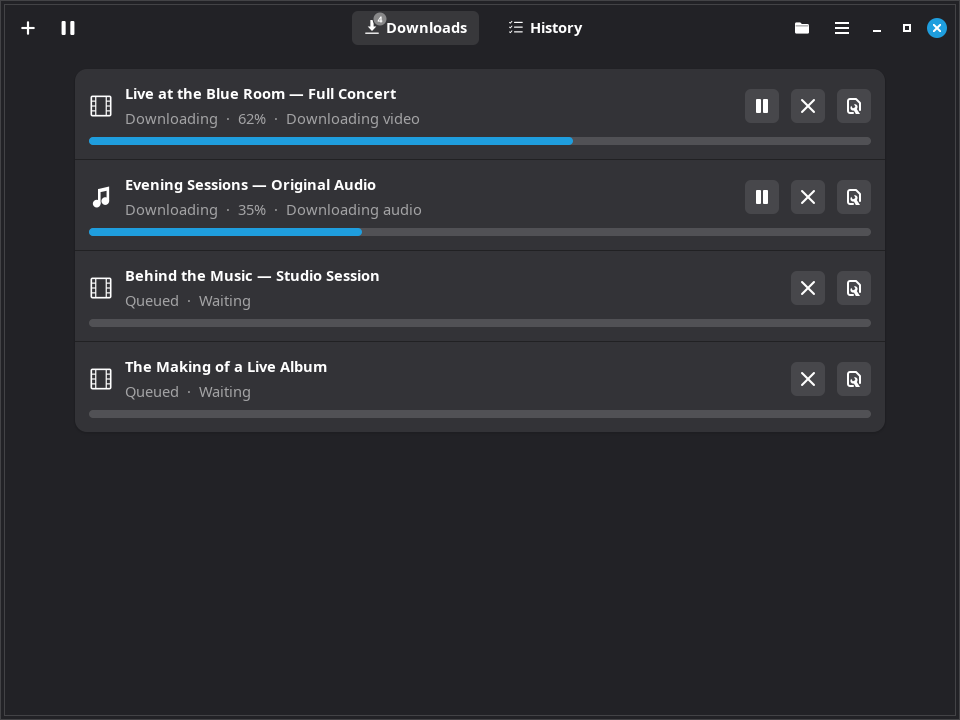
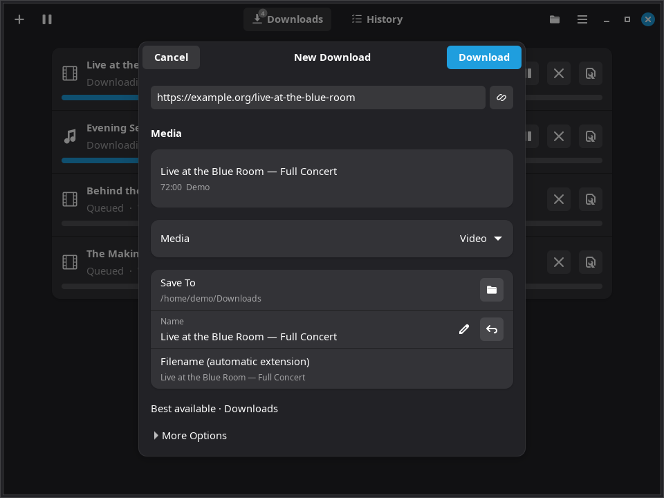
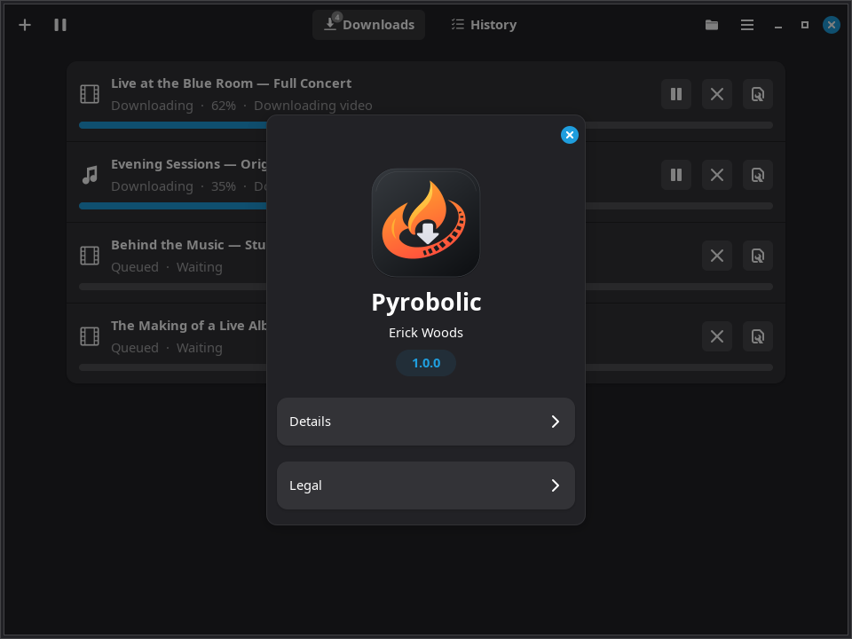

Pyrobolic
=========

**Fast, native Linux media downloads for GNOME and Cinnamon.**

Paste a link, choose video or audio, and download. Pyrobolic keeps everyday
choices simple, with detailed format, subtitle and playlist controls when you
need them. Built with Python, GTK 4 and libadwaita. **No .NET runtime.**
Powered by yt-dlp and FFmpeg.

`Download Pyrobolic 1.0 for Linux (.deb) <https://github.com/woodpile72/Pyrobolic/releases/download/v1.0.0/pyrobolic_1.0.0_all.deb>`_
· `Release notes <https://github.com/woodpile72/Pyrobolic/releases/tag/v1.0.0>`_
· `Report an issue <https://github.com/woodpile72/Pyrobolic/issues>`_

Screenshots show Pyrobolic 1.0 with demonstration titles, URLs and progress.

Install
-------

The tested target is **Linux Mint 22.3 / Ubuntu 24.04 on x86-64 (amd64)**.
Download the Debian package and
`SHA256SUMS <https://github.com/woodpile72/Pyrobolic/releases/download/v1.0.0/SHA256SUMS>`_
into the same folder, then run::

    sha256sum --ignore-missing -c SHA256SUMS
    sudo apt install ./pyrobolic_1.0.0_all.deb

Confirm that the package checksum reports ``OK``, then open **Pyrobolic** from
your application menu. For an upgrade, quit Pyrobolic first and use the same
installation command. Your settings, History and downloaded files are retained.

The package declares its desktop and media dependencies, including GTK 4.14+
and libadwaita 1.5+. A Secret Service provider such as GNOME Keyring is recommended
for saved credentials. The ``all`` package contains architecture-independent
Python; other architectures and distributions have not been verified.

What it does
------------

* **Quick downloads:** clipboard URL prefill, remembered choices and Quick
  Download, with review before starting playlists.
* **Clean filenames:** editable suggestions, optional source IDs, removal of
  recognized view/reaction counters, and collision handling that protects
  existing files.
* **Queues and playlists:** up to ten concurrent jobs, progress, cancellation,
  retries, queue pausing and supported active-transfer pausing. Search and select
  playlist entries, reorder and number them, or set individual names,
  destinations and time ranges.
* **Batch workflows:** import URL lists and TSV batches, explicitly import the
  supported Parabolic pipe-separated format, and export completed batches as
  relative-path M3U8 playlists.
* **Source selection:** Best Available by default, remembered quality, codec,
  frame-rate and bitrate preferences, or strict per-video source streams.
  Unmet preferences produce notices; exact stream choices are not silently
  replaced.
* **Video and audio:** MP4, WebM, MKV, MOV and AVI; MP3, M4A, Opus, FLAC, WAV and
  Ogg/Vorbis. Remux compatible streams or explicitly convert with encoder and
  quality controls. Video-only output is available too.
* **Subtitles:** searchable languages, selected or all languages, manual and
  generated tracks, sidecar files, supported embedding, output-format choices
  and missing-track policies.
* **Media processing:** metadata, descriptions, chapters and artwork, time-range
  downloads, and chapter splitting into numbered files.
* **SponsorBlock:** optional chapter marking or segment removal with category
  selection. Off by default. Supported combinations and restrictions are
  described in the release notes.
* **Authentication and network controls:** selected browser cookies/profiles,
  cookie files, supported login and video passwords, Secret Service storage,
  rate limits, fragment concurrency, proxy/direct choices and sleep prevention.
* **History and recovery:** search, sort, Details, open files or folders,
  retry/redownload and optional clearing of successful records. Removing a
  History record keeps published media. Saved-state recovery preserves damaged
  data, and completion checks require nonempty output files.
* **Desktop integration:** configurable completion notifications, Show in
  History, optional folder opening, a header folder shortcut, keyboard actions,
  remembered window size and adaptive GNOME-style navigation.
* **Private download support:** managed yt-dlp, Deno and JavaScript support for
  YouTube, with staged updates that preserve the working version on failure or
  cancellation. System installations are kept separate.

Keep downloading in the background
----------------------------------

Enable **Keep running when the window closes** to keep a long playlist going
while the main window is hidden. With a working tray host, the icon stays
available even when the queue is empty.

Click the tray icon to reopen Pyrobolic, or use its menu to **Add Download**,
show the window or **Quit**. Choose a color icon or a theme-aware **Symbolic**
icon for your panel. Tray Quit, main-menu Quit and ``Ctrl+Q`` use the same safe
shutdown path. Launching Pyrobolic again opens the existing instance.

Tray availability depends on the desktop. Cinnamon supports this workflow;
GNOME needs a compatible tray extension. Without a tray host, closing the
window behaves normally.

Made for the Linux desktop
--------------------------

Native GTK 4 and libadwaita controls, adaptive layouts, light/dark appearance
and progressive disclosure keep the interface focused. The design follows
GNOME interaction patterns while supporting Cinnamon's tray workflow.

Useful shortcuts: ``Ctrl+N`` for New Download, ``Ctrl+I`` for batch import,
``Ctrl+1`` / ``Ctrl+2`` for Downloads / History, ``Ctrl+F`` to search History,
and ``Ctrl+Shift+O`` to open the download folder.

Source and development
----------------------

To build the released source with Git, Python 3.12 and Debian packaging tools::

    git clone https://github.com/woodpile72/Pyrobolic.git
    cd Pyrobolic
    git checkout v1.0.0
    python3 release.py /tmp/pyrobolic-release --base-version --commit v1.0.0

Use a new output directory. The release tool builds the specified commit.
With the application dependencies installed, run the standard tests with::

    python3 -m unittest discover -s tests -q

Real-media integration tests are opt-in with ``PYROBOLIC_INTEGRATION=1``.
Use isolated HOME/XDG directories and a private session bus for integration
tests, and a private Xvfb display for UI tests.

Current scope
-------------

Linux is the focus; there are no Windows or macOS releases. Website support
depends on yt-dlp and each site's access rules. Pyrobolic does not bypass DRM.
Some format and processing combinations are unsupported; see the
`1.0 release notes <https://github.com/woodpile72/Pyrobolic/releases/tag/v1.0.0>`_
for detailed limits, including SponsorBlock combinations and authentication.
Broader screen-reader, Wayland and panel testing remains ongoing.

License and credits
-------------------

Copyright 2026 Erick Woods. Licensed under `GPL-3.0-only <LICENSE>`_.

Thanks to yt-dlp, FFmpeg, Python, PyGObject, GTK, libadwaita, GLib/Gio,
GdkPixbuf, libsecret, python-xlib, Deno and SponsorBlock.
See `NOTICE <NOTICE>`_ for third-party acknowledgments.
